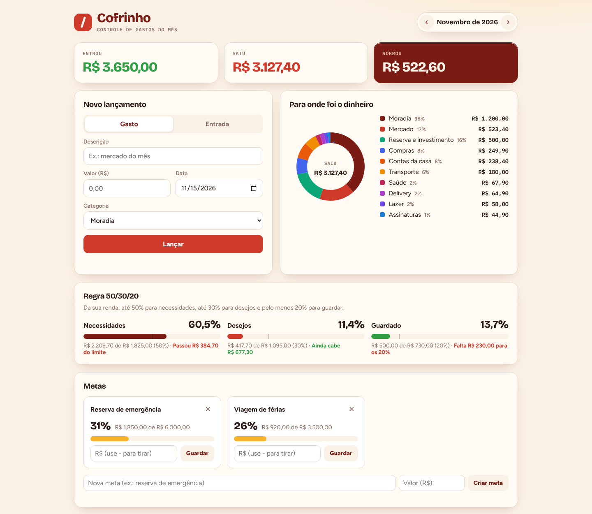

# Cofrinho

Controle de gastos do mês, com a regra 50/30/20 e metas de economia.
Feito do zero, passo a passo, no canal **Sem Pauta**.



## O que ele faz

- Lança entradas e gastos com categoria e data
- Mostra quanto entrou, quanto saiu e quanto sobrou no mês
- Gráfico de rosca com os gastos por categoria (SVG puro, sem biblioteca)
- Compara seus gastos com a regra 50/30/20
- Metas de economia com barra de progresso
- Exporta o mês em planilha (CSV que abre no Excel e no Google Sheets)
- Funciona no celular

## Como rodar

Precisa do [Node.js](https://nodejs.org) 22.13 ou mais novo.

```bash
git clone https://github.com/sempauta/cofrinho.git
cd cofrinho
npm install
npm run exemplo   # opcional: enche o banco com um mês de exemplo
npm start
```

Abra http://localhost:3000.

| Comando | O que faz |
| --- | --- |
| `npm start` | sobe o servidor |
| `npm run dev` | sobe e reinicia sozinho quando você salva um arquivo |
| `npm test` | roda os testes |
| `npm run exemplo` | cria lançamentos e metas de exemplo |

## Como é feito

| Parte | Tecnologia |
| --- | --- |
| Servidor | Node.js + Express |
| Banco de dados | SQLite (`node:sqlite`, já vem no Node) — um arquivo em `data/cofrinho.db` |
| Tela | HTML, CSS e JavaScript puros |
| Testes | `node:test` (já vem no Node) |

```
src/
  server.js    liga o servidor
  app.js       rotas da API
  db.js        cria o banco e as tabelas
  dinheiro.js  converte "1.234,56" em centavos
  exemplo.js   dados de exemplo
public/
  index.html   a tela
  styles.css   o visual
  app.js       o que acontece na tela
test/          testes automáticos
```

Dinheiro é guardado em **centavos** (número inteiro), para nunca ter erro de arredondamento.

## API

| Método | Rota | Para quê |
| --- | --- | --- |
| GET | `/api/categorias` | lista as categorias |
| GET | `/api/lancamentos?mes=2026-11` | lançamentos do mês |
| POST | `/api/lancamentos` | cria um lançamento |
| DELETE | `/api/lancamentos/:id` | apaga um lançamento |
| GET | `/api/resumo?mes=2026-11` | totais, categorias e regra 50/30/20 |
| GET | `/api/metas` | lista as metas |
| POST | `/api/metas` | cria uma meta |
| POST | `/api/metas/:id/movimentos` | guarda (ou tira, com `-`) dinheiro da meta |
| DELETE | `/api/metas/:id` | apaga uma meta |
| GET | `/api/exportar?mes=2026-11` | baixa o mês em CSV |

Exemplo de lançamento:

```json
{ "tipo": "saida", "descricao": "Mercado", "valor": "150,00", "categoria_id": 4, "data": "2026-11-10" }
```

## Licença

MIT. Use, estude e modifique à vontade.
